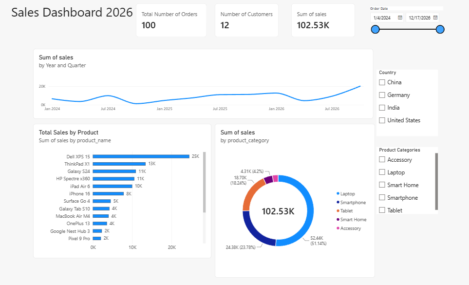

# PowerBi-Dashboard
A simple PowerBi Dashboard where you can analyze all the sales of company.
 

## 📊 Dashboard Overview & Key Components

Based on the dashboard structure, a Power BI report typically consists of several key interactive elements:

* **Top KPI Cards (Key Performance Indicators):**
  * Displays high-level summary metrics at a glance: **Total Number of Orders (100)**, **Number of Customers (12)**, and **Sum of Sales (102.53K)**.
* **Line Chart (Trends Over Time):**
  * Tracks the **Sum of sales by Year and Quarter**, visualizing revenue trends, fluctuations, and growth from January 2024 through late 2026.
* **Bar Chart (Ranking Data):**
  * Breaks down **Total Sales by Product** (e.g., *Dell XPS 15* leads with $25K), allowing instant identification of top-performing inventory items.
* **Donut Chart (Proportions):**
  * Displays the **Sum of sales by Product Category** (e.g., *Laptops* account for $52.44K or 51.14% of total sales), highlighting category distribution.
* **Slicers & Filters (Interactivity):**
  * Features custom filters for **Country** (*China, Germany, India, United States*), **Product Categories**, and an **Order Date** timeline slider. Clicking any filter dynamically updates all visual elements across the dashboard.
